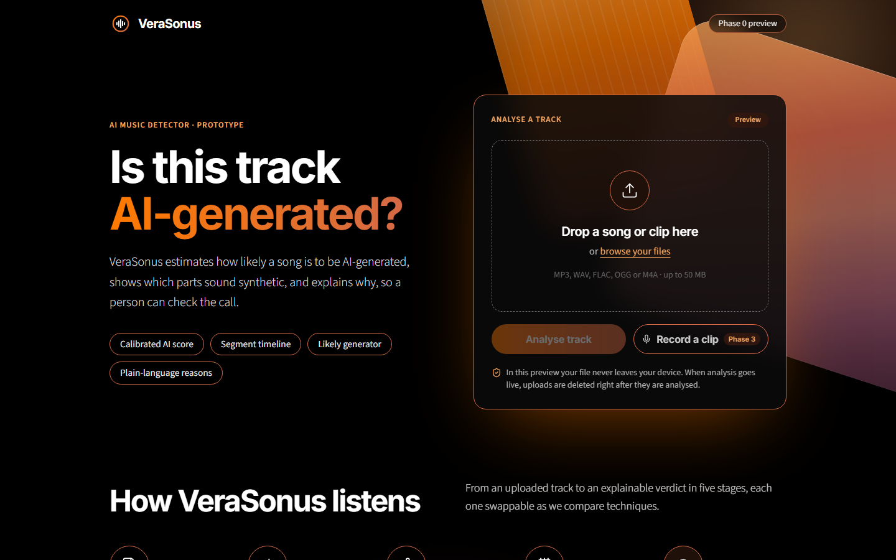

<p align="center">
  
</p>

<h1 align="center">VeraSonus</h1>

<p align="center">
  <b>Is this track AI-generated? Which parts? Why?</b><br />
  A pattern recognition system that detects, localises and explains AI-generated music.<br />
  <sub>NUS-ISS Pattern Recognition Systems practice module · Group 34 · Shrey Yadav &amp; Sushant Maramkulam Shiji</sub>
</p>

<p align="center">
  <a href="https://github.com/Hayzzy/verasonus/actions/workflows/ci.yml"></a>
</p>



## What it is

**VeraSonus** (Latin for "true sound") estimates how likely a music track is to be
AI-generated. It marks which segments look AI-generated, names the likely generator (or
"unknown"), and explains its decision so a person can check it. It should feel like a real
product, on par with tools such as IRCAM Amplify's AI music detector or SubmitHub's AI song
checker.

Our edge is **honesty and robustness**. Detectors that look near-perfect in the lab often break
on new generators and simple edits. So we measure how detection holds up on generators the
model has never seen and after everyday edits (MP3 compression, pitch shift, phone
re-recording), and we report those gaps as they are.

> **Status: Phase 1 in progress.** Implemented and tested: config loading, audio loading and
> resampling, windowing, splits, the dataset registry, and the clip table for FMA and
> FakeMusicCaps. Everything else is a documented stub (`NotImplementedError("Phase N")`) for
> the team to build. See the [roadmap](#roadmap).

## How the course requirements map to the code

The brief asks for at least three of four aspects. VeraSonus covers all four:

| Aspect | How VeraSonus covers it | Where (`src/verasonus/`) |
|---|---|---|
| **1. Supervised / unsupervised learning** | Real-vs-AI and which-generator classifiers; clustering and embedding maps of generators; outlier detection that flags unfamiliar generators as "unknown" | `models/classical.py`, `models/deep.py`, `models/probes.py`, `models/unsupervised.py` |
| **2. Machine / deep learning** | SVM, random forest and gradient boosting on handcrafted features; CNN and Transformer on spectrograms; MERT / CLAP embedding probes; SpecTTTra (SONICS) as reference baseline | `models/classical.py`, `models/deep.py`, `models/probes.py` |
| **3. Hybrid / ensemble approaches** | Stacking and weighted voting across model families; window scores fused into one calibrated track score and a timeline | `ensemble/fusion.py`, `ensemble/aggregation.py`, `ensemble/calibration.py` |
| **4. Intelligent sensing / sense-making** | Resampling and windowing; mel / CQT spectrograms, MFCCs, high-band and decoder-artefact features; Demucs stems; segment timeline, saliency maps, feature importance | `preprocessing/`, `features/`, `explain/`, `ensemble/aggregation.py` |

Final deliverables map to: the runnable system (`src/verasonus/api/` + `web/`), datasets
([docs/DATA.md](docs/DATA.md) + `scripts/`), report figures and tables (`reports/`), and code
and model files (this repo; model weights go to Hugging Face Hub or GitHub Releases, not git).

## Repository layout

```
verasonus/
├── src/verasonus/      Python package
│   ├── config.py         YAML config -> typed settings            (implemented)
│   ├── data/             dataset registry, clip table, splits      (implemented except download)
│   ├── preprocessing/    audio I/O, resampling, windowing          (implemented)
│   ├── augmentation/     codecs, pitch/time/noise/loudness, phone playback, hybrid stems
│   ├── features/         spectrograms, handcrafted features, MERT/CLAP, Demucs
│   ├── models/           classical, deep, probes, unsupervised
│   ├── ensemble/         fusion, window -> track aggregation, calibration
│   ├── evaluation/       metrics, protocols, report outputs
│   ├── explain/          saliency maps, feature importance
│   └── api/              FastAPI service (/health works, /analyze returns 501 until Phase 3)
├── configs/            default.yaml, datasets.yaml, augment.yaml
├── scripts/            download, metadata, splits, train, evaluate, ONNX export, icons
├── notebooks/          notebooks (00_colab_setup.ipynb is the optional Colab fallback)
├── tests/              pytest, synthetic audio only (no downloads)
├── web/                React + Vite + TypeScript + Tailwind PWA
├── extension/          Chrome extension, Manifest V3 skeleton (Phase 4)
├── docs/               DATA.md, AI_USAGE.md
├── reports/            figures/ and tables/ for the report
└── data/               datasets (ignored by git)
```

## Setup

### Local (Windows, macOS, Linux)

You need Python 3.12+ and Node.js 22.12+ (we use 24 LTS). Training also needs an NVIDIA GPU
and ffmpeg; see [Training on your own PC](#training-on-your-own-pc-gpu).

```bash
git clone https://github.com/Hayzzy/verasonus.git
cd verasonus
python -m venv .venv                # Windows: py -3.14 -m venv .venv
source .venv/bin/activate           # Windows: .venv\Scripts\activate
pip install -r requirements/dev.txt # exact pinned versions
pip install -e . --no-deps          # the package itself, editable
pytest                              # tests
ruff check . && ruff format --check .
```

**Web app** (Phase 0 preview: upload page with a local waveform preview)

```bash
cd web
npm ci
npm run dev      # http://localhost:5173 (proxies /api to the FastAPI service)
npm run build    # type-check + production build
```

**API**

```bash
uvicorn verasonus.api.main:app --reload   # docs at http://127.0.0.1:8000/docs
```

**iPhone.** The web app is a PWA. Once it is deployed over HTTPS (Phase 3), open it in Safari
and choose Share → Add to Home Screen. It then runs full screen and can record from the
microphone.

### Training on your own PC (GPU)

Training runs locally on an NVIDIA GPU. Our reference machine is a laptop with an RTX 5070
Laptop GPU (8 GB VRAM), 32 GB RAM and a 24-core CPU.

1. **Put the data on a roomy drive** and point the project at it, e.g. in `.env`:
   `VERASONUS_DATA_ROOT=D:/verasonus-data`
2. **Install PyTorch with CUDA, then the rest of the deep learning stack.** It is heavy, so
   agree as a team first. RTX 50-series GPUs need a CUDA 12.8+ build:
   ```bash
   pip install torch --index-url https://download.pytorch.org/whl/cu130
   pip install -r requirements/ml.txt
   python -c "import torch; print(torch.cuda.is_available(), torch.cuda.get_device_name(0))"
   ```
3. **Install ffmpeg** (needed for the codec edits from Phase 1) and check `ffmpeg -version`.

What fits in 8 GB of VRAM:
- **Fine:** CNN / Transformer / SpecTTTra training with mixed precision; MERT and CLAP
  embeddings; Demucs; EnCodec; MusicGen small/medium; Stable Audio Open in half precision.
- **Slow but possible:** ACE-Step with CPU offloading.
- **Too big:** YuE (~24 GB) and MusicGen-large. Skip them, or rent a cloud GPU for a few hours.

On a laptop, keep it plugged in, use the performance power mode, stop it from sleeping during
long runs, and save checkpoints often so a run can resume.

### Google Colab (optional fallback)

Training runs locally by default (see above). Colab stays available as a fallback, for example
for a teammate without an NVIDIA GPU. The code is the same either way; only
`VERASONUS_DATA_ROOT` and the torch install differ.

1. In Colab: File → Open notebook → GitHub. Tick "Include private repos" and open
   `notebooks/00_colab_setup.ipynb`.
2. Add a Colab secret `GH_TOKEN`: a GitHub fine-grained token with read access to this repo.
3. Run all. The notebook:
   - clones the repo and installs it with `pip install -e ".[api,dev]"` (version ranges, so
     Colab keeps its preinstalled torch)
   - mounts Google Drive and points `VERASONUS_DATA_ROOT` at it
   - runs the tests

### Configuration

| File | What it controls |
|---|---|
| `configs/default.yaml` | Paths, target sample rate (16 kHz), window length/hop, split ratios, held-out generators, seed |
| `configs/datasets.yaml` | Data sources: role, access, licence, links |
| `configs/augment.yaml` | Robustness suite: codecs and bitrates, pitch, stretch, noise, loudness, phone playback |

Override in code with `load_config(overrides={"audio.target_sample_rate": 32000})`.
Environment variables (see `.env.example`): `VERASONUS_DATA_ROOT` (where data lives) and
`HF_TOKEN` (gated Hugging Face models).

## Data

Audio is **never** committed; see [docs/DATA.md](docs/DATA.md) for sources, licences and
rules.

1. `python scripts/download_data.py --list` shows every source with its role and licence.
2. Download each source into `data/raw/<source>/`. The download script is a Phase 1 stub;
   follow the access notes in DATA.md until then.
3. `python scripts/build_metadata.py --sources fma fakemusiccaps` writes `metadata.csv` in
   the data root, one row per clip. Scanners exist for these two sources so far.
4. `python scripts/make_splits.py`, or `--holdout musicgen` for unseen-generator tests, adds a
   split column. Rows with the same `group_id` (an FMA artist, otherwise a track) stay
   together.

## Evaluation

We report the following, and never inflate it:

- **Metrics:** accuracy, precision, recall, F1, ROC-AUC, equal error rate, calibration (ECE)
  and confusion matrices. The false-positive rate on real music is reported separately.
- **Protocols:**
  - held-out tracks from seen generators
  - leave-one-generator-out
  - the robustness suite

  Each comes with per-generator and per-edit reports.
- **Aims:** ROC-AUC ≥ 0.95 and F1 ≥ 0.90 on held-out tracks from seen generators. The
  unseen-generator and robustness gaps are measured, then reduced as far as we can.
- **Sanity rule:** suspiciously perfect accuracy means we look for a shortcut before
  celebrating.
- **App performance:** a 30-second clip is analysed in a few seconds on CPU, using ONNX where
  it helps.

## Roadmap

- [x] **Phase 0:** repository scaffold, configs, tested utilities, web and extension skeletons, CI, docs
- [ ] **Phase 1:** data pipeline, metadata table, splits, augmentation suite, classical baselines
- [ ] **Phase 2:** deep models, embedding probes, ensemble, calibration, full evaluation reports
- [ ] **Phase 3:** FastAPI service and the polished PWA web app (the working prototype)
- [ ] **Phase 4:** Chrome extension (tab capture), then iPhone options
- [ ] **Throughout:** report-ready figures and tables saved to `reports/`

## Design

The web app, extension and icons use the theme of our slides:

- **Colours:** black background; flame `#FF7A00` and ember `#D56A46` gradients; apricot
  `#F7A760` labels; thin ember outlines on rounded cards.
- **Fonts:** Inter headings and Source Sans 3 body text.

The design tokens live in [`web/src/index.css`](web/src/index.css); the icons come from
`scripts/make_icons.py`.

## Team, AI usage and licence

- Shrey Yadav and Sushant Maramkulam Shiji.
- AI assistance is logged in [docs/AI_USAGE.md](docs/AI_USAGE.md), as the course requires.
- Code is released under the [MIT licence](LICENSE). Datasets keep their own licences.

## Key references

- Afchar et al. (2024). *Detecting music deepfakes is easy but actually hard.*
- Rahman et al. (ICLR 2025). *SONICS: Synthetic Or Not – Identifying Counterfeit Songs.*
- Comanducci et al. (2025). *FakeMusicCaps: a dataset for detection and attribution of synthetic music.*
- Batra et al. (TMLR). *Melody or Machine: detecting synthetic music with dual-stream contrastive learning.*
- Rigaud et al. (2026). AI-generated stems in hybrid music (Deezer).
